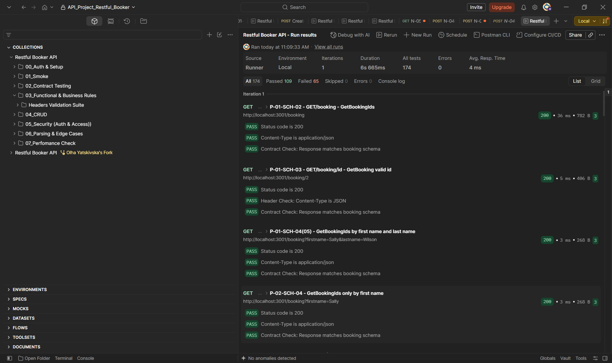
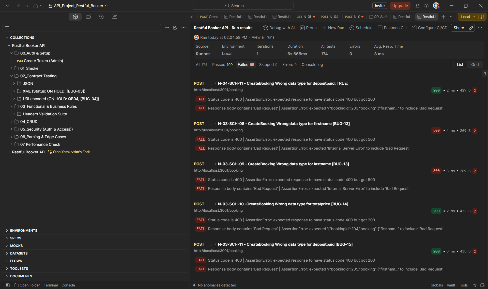

## Contract Testing (IN PROGRESS)

### Overview & Objective
This section covers the API contract testing phase for the **Restful Booker API**, focusing on schema validation, HTTP response code compliance, data type constraints.

---

### Interactive Artifacts
* **Google Sheets Analysis:** [View Test Analysis Online](https://docs.google.com/spreadsheets/d/1JyiP7P8-y5kIP1tJ0QuwbAnAP90Btph4AVkKAvTaxKc/edit?usp=sharing)
* **Postman Collection:** [Restful_Booker_API_postman_collection.json](./rest-api/4-test-implementation/Restful_Booker_API_postman_collection.json)

---

### Test Execution Metrics

| Metric | Details / Breakdown |
| :--- | :--- |
| **Total Test Conditions** | 172 conditions |
| **Covered Conditions** | 109 covered across 174 test cases (109 Passed, 65 Failed) |
| **Skipped Conditions** | 10 skipped (Auth strategy conditions: Basic Auth vs. Cookie-based auth on DELETE/PUT/PATCH) |
| **Uncovered Conditions** | 53 remaining |
| **Test Coverage** | **63%** |

#### Note on Skipped Conditions
The **10 skipped conditions** evaluate state-changing operations (`PUT`, `PATCH`, `DELETE`) requiring specific authentication mechanisms (Basic Auth headers vs. session cookies). These cases were temporarily skipped during this initial schema pass to isolate unauthenticated contract boundaries and will be executed during the dedicated Auth & Access control test run.

---

### Execution Evidence

#### Postman Successful Test Run Overview
  
*Figure 1: Full Postman runner output showing successful contract schema validations and header checks for JSON endpoints.*

#### Postman Failed Test Cases & Schema Mismatches
  
*Figure 2: Execution run highlighting contract assertions failing on incorrect status codes (expecting 400 Bad Request but receiving 200 OK or 500 Internal Server Error).*

---

### Identified Bugs & Schema Mismatch Log

#### 1. Incorrect HTTP Response Codes
| Identifier | Title |
| :--- | :--- |
| **SCH-BUG-01** | `[GET /ping]` endpoint returns HTTP status `201 Created` instead of `200 OK` (Linked to: REQ-BUG-01) |
| **SCH-BUG-05** | `CreateToken` returns `200 OK` with payload `"reason": "Bad credentials"` for missing/empty data |
| **SCH-BUG-06** | `[DELETE /booking]` returns `201 Created` instead of `200 OK` or `204 No Content` (Linked to: REQ-BUG-02) |
| **SCH-BUG-12** | `[DELETE /booking/:id]` returns `405 Method Not Allowed` when deleting non-existent entity or invalid format |

#### 2. Schema, Data Type & Deserialization Issues
| Identifier | Title |
| :--- | :--- |
| **SCH-BUG-03** | `GetBooking` returns wrong `Content-Type` header when requesting `application/xml` |
| **SCH-BUG-04** | API returns `200 OK` with unhandled JS exception body when requesting `application/x-www-form-urlencoded` |
| **SCH-BUG-07** | `CreateBooking`: XML deserialization layer on server sets `"depositpaid": false` to `true` |
| **SCH-BUG-09** | `[POST/PUT /booking]` Invalid data type in `additionalneeds` field is accepted with `200 OK` |
| **SCH-BUG-10** | `[PATCH /booking]` Partial update of `checkin` date corrupts `checkout` to `"0NaN-aN-aN"`, breaking schema contract |
| **SCH-BUG-14** | `[POST/PUT /booking]` `UpdateBooking` with wrong format for `totalprice` returns `200 OK` with `null` |
| **SCH-BUG-15** | `[POST/PUT /booking]` `depositpaid` field always evaluates to `true` for any non-zero value |
| **SCH-BUG-16** | `[POST/PUT /booking]` Invalid `checkin`/`checkout` data type causes date corruption displaying as `'0NaN-aN-aN'` |

#### 3. Edge Cases, Boundary Value Analysis (BVA) & Input Validation
| Identifier | Title |
| :--- | :--- |
| **SCH-BUG-02** | `GetBookingIds` by check-in/check-out date returns empty array `[]` — BVA check-in misses min boundary |
| **SCH-BUG-08** | `[GET /booking]` Invalid check-in/check-out date format causes `500 Internal Server Error` |
| **SCH-BUG-11** | `[POST /booking]` Missing input validation causes `500 Internal Server Error` on omitted mandatory fields |
| **SCH-BUG-13** | `[POST/PUT /booking]` Missing validation for name fields leads to `500 Internal Server Error` |

---

### Next Steps & Coverage Roadmap
* **Target Uncovered Conditions:** Execute test cases for the remaining 53 test conditions to increase overall coverage beyond 63%.
* **Re-testing & Bug Tracking:** Re-evaluate failed contract assertions once backend bug fixes for date corruption (`0NaN-aN-aN`) and unhandled `500` status codes are addressed.
* **Negative Schema Coverage:** Expand JSON/XML schema assertions to validate unexpected additional properties and null inputs systematically.

---
