[Back](./)

## Advanced Concept: Analytical Coverage

When designing tests, **exhaustive coverage** (testing every single possible combination) is often mathematically impossible due to combinatorial explosion. Furthermore, some input fields have near-infinite possibilities. 

To solve this, making analytical decisions to group classes into **logical partitions** using Equivalence Partitioning and Boundary Value Analysis is the best solution. 

## Analytical Example: Microsoft Word Font Menu

Unlike Style, Strikethrough, Height, and Caps - which have a finite set of values - Font Size has 1.638 possible values. Creating a class (leaf node) for every single size is impossible. Instead, grouping the inputs into logical, testable equivalence partitions: **Small (8), Typical (12), and Large (72)**. Additional can be tested boundaries (BVA):  0 | 1    1638 | 1639.

Here is the [resulting Classification Tree](https://app.diagrams.net/#G1LGmr5C4NmzL2OUjF26MR92mzPRWVg0x3#%7B%22pageId%22%3A%22zQOh_qRSnj4YGN4gHR6b%22%7D) based on analytical grouping:

```mermaid
graph TD
    Root(["Font"])
    
    %% Classifications (Parameters)
    Font["Font"]
    Style["Style"]
    Strikethrough["Strikethrough"]
    Height["Height"]
    Caps["Caps"]

    Root --> Font
    Root --> Style
    Root --> Strikethrough
    Root --> Height
    Root --> Caps


    %% Define the style once
    classDef noBorder stroke-width:0px;

    %% Classes (Partitions) - Style applied directly using :::
    Font --> Small_8["Small(8)"]:::noBorder
    Font --> Typical["Typical(12)"]:::noBorder
    Font --> Large["Large(72)"]:::noBorder

    Style --> Regular["Regular"]:::noBorder
    Style --> Italic["Italic"]:::noBorder
    Style --> Bold["Bold"]:::noBorder
    Style --> Bold_ital["Bold Italic"]:::noBorder
    

    Strikethrough --> No["No"]:::noBorder
    Strikethrough --> Yes["Yes"]:::noBorder
    Strikethrough --> Double["Double"]:::noBorder

    Height --> Normal["Normal"]:::noBorder
    Height --> Subscript["Subscript"]:::noBorder
    Height --> Superscript["Superscript"]:::noBorder

    Caps --> Normal_caps["Normal"]:::noBorder
    Caps --> Small_caps["Small caps"]:::noBorder
    Caps --> All["All caps"]:::noBorder
```

## Why this approach matters:
By applying analytical grouping, we reduce the "Font Size" parameter from 1,638 possible inputs down to just 3 highly effective test classes. When combined with Pairwise (2-wise) testing across the other classifications (Style, Strikethrough, Height, Caps), we can achieve maximum defect detection with a minimal, highly efficient number of test cases.
   
  
--- 

See also:

* **[Classification Tree Examples](./README.md)** - More practical example.
* **[Classification Tree Testing](https://olha-yatskivska.github.io/classification-tree.html)** -  Summary of the core concepts from ISTQB Advanced Test Analyst. 
* **[Classification Tree Tools](https://olha-yatskivska.github.io/classification-tree-tools.html)** - Links for the most popular tools.
* **[Back to Main Page](./)**

