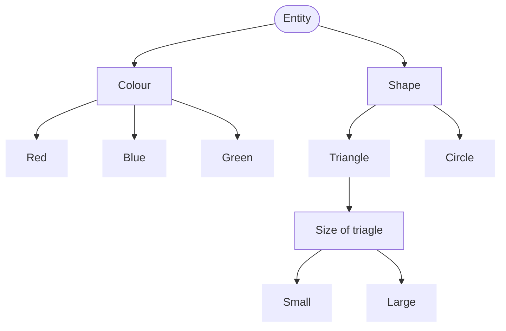

[Back](./)

# Complex Dependencies (Nested Classifications)

## The Concept
In the Classification Tree Method, **Hierarchical Dependencies** occur when a parameter (classification) is only relevant based on the selection of a previous class. Instead of creating complex constraints to block invalid combinations, we nest the dependent parameter directly under the relevant class. 

## Scenario: Graphic Object Generator
Imagine we are testing a simple graphic design tool that generates shapes based on user input.

### Requirements:

| Identifier | Requirements |   Traceability   |
| :--        | :--          | :--              |
| R01 | Every generated entity must have a defined **Colour** and **Shape** | TC01 - TC06 | 
| R02 | Available colours are Red, Blue, and Green | TC01 - TC05 |
| R03 | Available shapes are Triangle and Circle | TC01 - TC03, TC06  |
| R04 | If a **Triangle** is selected, the system requires the user to specify a **Size** (Small or Large)|  TC01 - TC02, TC07 |
| R05 | If a **Circle** is selected, the size is fixed by the system, and the Size parameter is disabled/hidden from the user |   TC03, TC08  | 

## Questions 

| Identifier | Requirements                               |   Traceability   |
| :--        | :--                                        | :--              |
| Q01        | What is a default fixed size for a Circle? | R05, TC03          |  

### Based on these rules, we nest the "Size" classification directly under the "Triangle" class:

## Combination Table (Handling Dependencies)

> Note: if "Circle" is selected, the Size classes are marked with a dash (-) because they are logically impossible and out of scope for that test case.

1. Test suit for minimal coverage, ensuring every valid leaf node is hit at least once

| Test Case  | Traceability   |  Red | Blue | Green | Triangle | Circle | Small | Large | Expected Result   |
| :--:       |  :--:          | :--: | :--:  | :--:  | :--:   | :--:    | :--:  | :--:  | :--:                 |
| TC01       | R01-R04        |   ●  |      |       |   ●      |        |   ●   |       | Generated triagle has red colour and small size |   
| TC02       | R01-R04        |      |  ●   |       |   ●      |        |       |   ●   | Generated triagle has blue colour and large size |
| TC03       | R01-R03, R05   |      |      |   ●   |          |   ●    |   -   |   -   | Generated circle has green colour and fixed size (pending Q01 clarification) |

2. Constraint Verification / Error Handling Tests: 

| Test Case  | Traceability   |  Description                                                | Expected Result   |
| :--:       |  :--:          | :--:                                                        | :--:                 |
| TC04  | R01-R02        |  Try to generate a circle without colour                    | Can't generate,  Check UI on Nielsen's Usability Heuristics  |   
| TC05  | R01-R02        |  Try to generate a triagle  without colour                  | Can't generate,  Check UI on Nielsen's Usability Heuristics  |
| TC06  | R01, R03       |  Try to generate an entity without shape                    | Can't generate,  Check UI on Nielsen's Usability Heuristics  |
| TC07  | R04            |  Try to generate a triagle  without shape                   | Can't generate,  Check UI on Nielsen's Usability Heuristics  |
| TC08  | R05            |  Try to select size for a circle                            | The Size parameter is disabled/hidden from the user          |

---

See also:
* **[Classification Tree Examples](./README.md)** - More practical examples.
* **[Classification Tree Testing](https://olha-yatskivska.github.io/classification-tree.html)** -  Summary of the core concepts from ISTQB Advanced Test Analyst. 
* **[Classification Tree Tools](https://olha-yatskivska.github.io/classification-tree-tools.html)** - Links for the most popular tools.
* **[Back to Main Page](./)**
