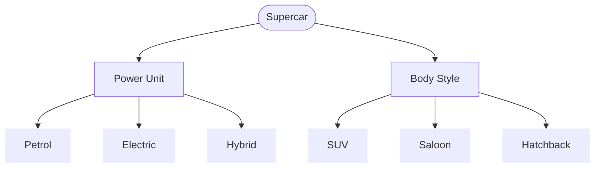

[Back to Main Page](../../README.md)

[Back](./)

# Supercar Classification Tree (2-wise)

> Note: On this small set 2-wise coverage = exhaustive coverage. 

## Requirements:

| Identifier | Requirements                                                                                                                                                            | Traceability                                    |
| --         | --                                                                                                                                                                      | :--                                             |
| R01       | Supercar is an online vehicle sales website specializing in a single manufacturer's Sports Utility Vehicles (SUVs) and saloons                                           |  TC-V-01 - TC-V-07, TC-InV-01 - TC-InV-02        |  
| R02       | A vehicle has two key elements, power unit and body style                                                                                                                |  TC-V-01 - TC-V-07, TC-InV-01 - TC-InV-02        |                                                    
| R03       | The manufacturer offers three choices of power unit: petrol, electric and hybrid                                                                                         |  TC-V-01 - TC-V-07, TC-InV-01 - TC-InV-02        | 
| R04       | There are 3 main body styles: Saloon, Hatchback and SUV                                                                                                                  |  TC-V-01 - TC-V-07, TC-InV-01 - TC-InV-02        |
| R05       | SUVs are available only as petrol and electric options                                                                                                                   |  TC-V-01,  TC-V-04, TC-InV-01                    |
| R06       | Hybrid is available for Hatchback only                                                                                                                                   |  TC-V-07,  TC-InV-01  - TC-InV-02                 |
| R07       | The website will allow an order to be processed if the chosen vehicle configurations is in stock, otherwise, a message will be displayed to the user to try again later  |   A01,  TC-V-01 -TC-V-07, TC-InV-03  |

## Questions and Assumptions

| Identifier | Questions                                                                                                                                                                                                                                                  | Assumption |
| :--        | :---                                                                                                                                                                                                                                                       | :--        |
| Q01        | R07: By the chosen vehicle configurations is in stock - are we talking about availability or possibility?  A message will be displayed to the user when vechile with valid configuration is out of stock or a user combine invalide configuration (R05, R06) | A01: valid configuration is out of stock |
| Q02        | If R07 cover "out of stock" (valid config, temporarily unavailable) what should the system display for an impossible/invalid config (violating R05/R06)? Showing "try again later" would be misleading. Is there a separate error message for invalid config? | pendig for clarification, possible requirement gap | 

---

Based on the specification, the [following classification tree](https://app.diagrams.net/#G1LGmr5C4NmzL2OUjF26MR92mzPRWVg0x3#%7B%22pageId%22%3A%22h1yfxWF85LsedUhxNonw%22%7D) has been developed: 

## Combination Table with derived test cases 

> Note:  TC-V - valid test cases,  TC-InV - invalid test cases

| Test Case     | Traceability      | Petrol | Electric | Hybrid | SUV  | Saloon | Hatchback | Expected Result                                             | 
| :----         | :---              | :--:  |   :--:   |  :--:  | :--: |  :--:  |    :--:   | :--                                                          |
| TC-V-01       |  R02-R05, R07     |   ●   |          |        |   ●  |        |           | an order is  processed                                       |  
| TC-V-02       |  R02-R04, R07     |   ●   |          |        |      |    ●   |           | an order is  processed                                       |  
| TC-V-03       |  R02-R04, R07     |   ●   |          |        |      |        |      ●    | an order is  processed                                       |  
| TC-V-04       |  R02-R05, R07     |       |     ●    |        |   ●  |        |           | an order is  processed                                       |  
| TC-V-05       |  R02-R04, R07     |       |     ●    |        |      |    ●   |           | an order is  processed                                       |  
| TC-V-06       |  R02-R04, R07     |       |     ●    |        |      |        |      ●    | an order is  processed                                |  
| TC-V-07       |  R02-R07          |       |          |    ●   |      |        |      ●    | an order is  processed                                |  
| TC-InV-01     |  R02-R05, R06     |       |          |    ●   |  ●   |        |           | an order isn't processed, pending Q02 clarification for ER   |
| TC-InV-02     |  R02-R04, R06     |       |          |    ●   |      |    ●   |           | an order isn't processed pending Q02 clarification for ER |
| TC-InV-03 (out of stock)  |  R07  |       |          |    ●   |      |        |      ●    | an order isn't  processed, a message will be displayed to the user to try again later |

---

See also:

* **[Classification Tree Examples](./README.md)** - More practical examples.
* **[Classification Tree Testing](https://olha-yatskivska.github.io/classification-tree.html)** -  Summary of the core concepts from ISTQB Advanced Test Analyst. 
* **[Classification Tree Tools](https://olha-yatskivska.github.io/classification-tree-tools.html)** - Links for the most popular tools.

* **[Back to Main Page](./)**
