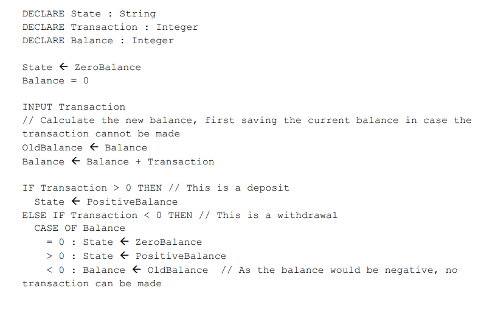
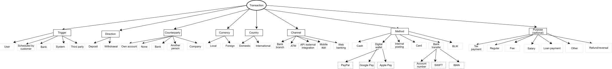
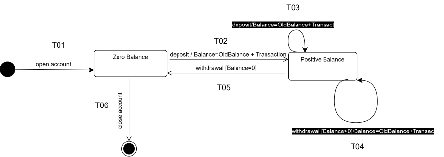

[Back to Main Page](../../README.md)

# The Bank Account Example

## Requirements: 

The account has two states, one for zero balance, and one for a positive balance. Withdrawals are not allowed if this would cause a negative balance.

### Bank account algorithm 

R01: The account has two states - Zero Balance(S1) and Positive Balance (S2).   

R02: Deposits (Transaction > 0) always transition to or remain in Positive Balance (S2).  

R03: Withdrawals (Transaction < 0) are allowed only if the resulting balance ≥ 0.   

R04: If a withdrawal would cause a negative balance, the transaction is rejected and the balance is restored from OldBalance.   

R05: A withdrawal that reduces balance to exactly 0 transitions to Zero Balance (S1).   

R06: A withdrawal from Positive Balance (S2) that leaves balance > 0 remains in Positive Balance (S2).

R07: In this algorithm, Balance and Transaction are declared as Integer. Production representation requires clarification (pending Q11 clarification))

---

## Questions 

| # | Questions to BA |
| :--- | :--- | 
| **Q01** | What are the guard conditions, initial and final states for opening and closing an account? Or is openning/closing out of scope for this iteration?  |
| **Q02** | How are cancelled or reversed transactions handled? Do we need an additional state, or is cancellation out of scope for this task?  | 
| **Q03** |  What is the mechanism for handling failed transactions due to incorrect recipient details, e.g. wrong account number? Rollback, rejection, or manual intervention?  | 
| **Q04** | What type of account is this: personal, business, savings, checking? Are there transfer limitations by source, currency, amount, or frequency?  | 
| **Q05** | Where can I find the documented transaction limits: by account, bank, country, currency, channel/ATM, etc.? Needed for BVA test design. | 
| **Q06** | Please review the draft classification tree for the Transaction entity. Which dimensions and values are valid for this system, which are out of scope, and which should be prioritized for smoke, regression, or extended/risk-based test coverage? See the classification tree below |  
| **Q07** | Are simultaneous transactions from multiple users on the same account allowed, e.g. joint account/family account? If yes, transaction anomaly testing becomes in scope. Check  the note  [transaction anomalies](https://github.com/olha-yatskivska/qa-artifacts/blob/main/test-design/cheat-sheets/catalog-test-cases-transaction-anomalies.md)  for test design |
| **Q08** | How does the system record bank fees and commissions - as separate transactions with counter-party = Bank, or as adjustments to the main transaction? Affects test data setup. |
| **Q09** | How are FX rate spreads recorded? Separate transaction or bundled? |
| **Q10** | Are there regulatory reporting thresholds (e.g., AML for large transactions) that we need to test for? Which amounts trigger alerts? |
| **Q11** | The algorithm declares Transaction and Balance as Integer. In the real system, are amounts stored as integer minor units, e.g. cents/grosze, or as decimal values? What precision and rounding rules should be used?  |
| **Q12** | How should Transaction = 0 be handled ? Should it be rejected, ignored as no operation? Are there any error messages for the users? |
| **Q13** | How should system inform the users about withdrawal exceeding balance? Or when the users try to withdraw from Zero Balance? |
| **Q14** | Can be reopened already closed account? |
| **Q15** | Can multiple transactions be processed concurrently or in a single batch on the same account? If so, are they serialized or parallel, and is each balance update atomic? This affects state-transition sequencing and race-condition test design. Check the note  [transaction anomalies](https://github.com/olha-yatskivska/qa-artifacts/blob/main/test-design/cheat-sheets/catalog-test-cases-transaction-anomalies.md)  |
| **A01** (from Q01)  | A01: Pending Q01 clarification, the account opens in Zero Balance and can be closed only from Zero Balance. | 

---

## Test analysis 

| Entity | Applicable Techniques | Rationale |
| :-- | :-- | :-- |
| balance | EP + BVA | Numeric variable with critical boundaries (0) |
| transaction (amount) | EP + BVA | Numeric variable with sign-based semantics |
| state | State transition | Two discrete states with defined transitions |
| transaction (entity) | Classification tree + EP | Multi-dimensional categorical entity |
| limit | BVA (pending Q05) | Boundary conditions for max transfer |

1. EP + BVA techniques can be applied to:

 * the entity `Balance` (pending Q11 clarification) (here we are testing Balance after transaction)

| Identifier | Partition | Range | Boundary Values | Traceability | 
| :-- | :-- | :-- | :-- | :-- |
| EP01| Negative | balance < 0 (invalid) | -1 | TC03, TC07 |
| EP02 | Zero | balance = 0 | 0 | TC02, TC09 |
| EP03 | Positive | balance > 0 | 1, arbitrary large, max limit | TC04, TC06, TC08 |

* the entity `Transaction amount` (pending Q11 clarification) (here we are checking transaction amount according to OldBalance (before we do this transaction))

| Identifier | Partition | Range | Test Focus | Traceability |
| :-- | :-- | :-- | :-- | :-- |
| EP04 | Deposit | Transaction > 0   | 1, positive value, max limits after Q05 | TC04, TC06 | 
| EP05 | Zero transaction | Transaction = 0 | 0, pending Q12  | TC02 | 
| EP06 | Withdrawal leaves positive balance	 | Transaction < 0 and Balance after calculation > 0  |  Example: OldBalance=100, Transaction=-99 | TC08 |
| EP07 | Withdrawal empties account |  Transaction < 0 and Balance after calculation = 0 |  Example: OldBalance=100, Transaction=-100 | TC09 |
| EP08 | Withdrawal exceeds balance | Transaction < 0 and Balance after calculation < 0| Example: OldBalance=100, Transaction=-101, pending Q13| TC03, TC07 |

* all kind of limits (pending Q05 clarification)

  
---

2. EP + Classification Tree can be applied to:

 * the entity `Transaction`:

> Not all combinations are valid. Constraints will be applied during test case design after BA confirmation and review of the draft classification tree.   

## [Classification Tree - Transaction Entity](https://app.diagrams.net/#G14NRQ_vgreyrP4KkJzrxV-850lzoPQe1I#%7B%22pageId%22%3A%22Hk7BdSPNTpBIpQSyoqpu%22%7D) 

---

3. State transition diagram based on Bank Account Algorithm + Assumption A1:

## [State Transition Diagram - Bank Account](https://app.diagrams.net/#G14NRQ_vgreyrP4KkJzrxV-850lzoPQe1I#%7B%22pageId%22%3A%22ScZc_OdmlJIWL--C_Hh6%22%7D) 

> In withdrawal guards
> * Balance means the value after executing Balance ← Balance + Transaction.     
> * OldBalance means the balance before the transaction.

---

## Coverage: 

> * valid - allowed transition per state-transition diagram
> * invalid - event is defined but rejected (negative test)
> * N/A - combination is logically impossible (e.g., open while already open; withdrawal[Bal>0] from Zero Balance)
> * T - transition

| Current State ↓ / Event → | open | deposit (T>0) | withdrawal [Bal=0] | withdrawal [Bal>0] | withdrawal [Bal<0] | close |
| :-- | :-- | :-- | :-- | :-- | :-- | :-- | 
| Zero Balance | N/A | Positive (T02, TC04) | - (invalid, TC02) | N/A | - (invalid, TC03) | final (T06) |
| Positive Balance | N/A | Positive (T03, TC06) | Zero (T05, TC09) | Positive (T04, TC08) | -  (invalid, TC07) | - (invalid, TC10) |

* 0-switch/state transition coverage is based on applicable events per state, not every mathematical combination. 

| TC | Description | Type | Req/A/Q | EP/BVA | Current State | Events | Action | Next State | Transition | 
| -- | -- | -- | -- | -- | -- | -- | -- |   -- | -- |
| TC01 | Open account | valid |  A01 (Q01) | - | initial state | open account | Balance = 0 | Zero Balance  | T01 |
| TC02 | Transaction = 0 from Zero Balance | invalid | Q12  | EP05, EP02 |  Zero Balance | withdrawal [Balance = 0]  | (pending Q12 clarification) | Zero Balance | - | 
| TC03 | Withdrawal from Zero Balance exceeds balance | invalid | R04, Q13 | EP08, EP01 | Zero Balance | withdrawal [Balance < 0] | (pending Q13 clarification) | Zero Balance | - |  
| TC04 | Deposit from Zero Balance | valid | R02 | EP04, EP03 | Zero Balance | deposit  | OldBalance <- Balance, Balance <- Balance + Transaction |  Positive Balance | T02 |
| TC05 | Close from Zero Balance | valid | A01 (Q01) | - | Zero Balance | close account | close account procedure | final state | T06 | 
| TC06 | Deposit from positive Balance | valid | R02 | EP04, EP03 | Positive Balance | deposit  |  OldBalance <- Balance, Balance <- Balance + Transaction | Positive Balance | T03 | 
| TC07 | Withdrawal exceeds balance from positive Balance | invalid | R04, Q13 | EP08, EP01 | Positive Balance | withdrawal [Balance < 0]  |  Balance <- OldBalance |  Positive Balance | - | 
| TC08 | Withdrawal leaves positive balance | valid | R03, R06 | EP06, EP03 | Positive Balance | withdrawal [Balance > 0]  | Balance <- Balance + Transaction | Positive Balance | T04 | 
| TC09 | Withdrawal empties account | valid | R05, R03 | EP07, EP02 | Positive Balance | withdrawal [Balance = 0] | Balance = 0 | Zero Balance | T05 |
| TC10 | Try to close from Positive Balance | invalid | Q01 | Positive Balance | - | close account | - | Positive Balance | - | 

---

* 1-Switch additional test cases based on Risk-based Coverage Strategy and combination with EP+BVA test technique:

> * Covers valid transition pairs only.
> * Invalid events (e.g., withdrawal[Balance < 0] rejection) are excluded from 1-switch because their rejection logic is state-entry-independent - it depends only on the balance guard, already fully verified at 0-switch (TC03, TC07). Re-testing them in pair sequences would add no new behavioral coverage.
> * If future requirements introduce history-dependent behavior, invalid transition pairs would move into scope.

---

| TC | Type | Traceability | Precondition | Transition 1 | Intermediate | Transition 2 | End State | Path |
| :-- | :-- | :-- | :-- | :-- | :-- | :-- | :-- | :-- |
| TC11 | valid | R02, R03, R05 | Zero Balance  | T02 | Positive Balance | T05 | Zero Balance | T02 -> T05 |
| TC12 | valid | R02  | Zero Balance | T02 |  Positive Balance | T03 | Positive Balance | T02 -> T03 |
| TC13 | valid | R02, R06 | Zero Balance | T02 | Positive Balance  | T04 | Positive Balance | T02 -> T04 |
| TC14 | valid | R05, A01 (Q01) | Positive Balance | T05 | Zero Balance | T06 | final state | T05 -> T06 |
| TC15 | valid | R02, R05 | Positive Balance | T03 | Positive Balance | T05 | Zero Balance | T03 -> T05 |
| TC16 | valid | R06, R05 | Positive Balance | T04 | Positive Balance | T05 | Zero Balance | T04 -> T05 |
| TC17 | valid | R05, R02 | Positive Balance | T05 | Zero Balance | T02 | Positive Balance  | T05 -> T02 |
| TC18 | valid | R02, R06 | Positive Balance | T03 | Positive Balance | T04 | Positive Balance  | T03 -> T04 |
| TC19 | valid | R06, R02 | Positive Balance | T04 | Positive Balance | T03 | Positive Balance  | T04 -> T03 |
| TC20 | valid | R06 | Positive Balance | T04 | Positive Balance | T04 | Positive Balance  | T04 -> T04 |
| TC21 | valid | R02 | Positive Balance | T03 | Positive Balance | T03 | Positive Balance  | T03 -> T03 |
  
---

## Coverage Summary Table for state transition diagram

| Coverage Level | Test Cases | Count |
| :-- | :-- | :-- |
| 0-switch full (states × events) | TC01–TC12 | 10 |
| 1-switch coverage  | TC13–TC21 | 11 |
| Total |  | 21 |

---

## Out of Scope

Not covered in this example:

* N-switch coverage for N ≥ 2 (rationale: budget/risk/simplicity)
* Opening/closing procedure (pending Q01, Q14 clarification)
* Canceling operations (pending Q02 clarification)
* Error handling (pending Q02, Q10, Q12, Q13 clarification)
* BVA for limits (pending Q05, Q10 clarification)
* Validation (pending Q04 clarification)
* Classification Tree coverage (pending Q06 clarification)
* Simultaneous transactions from multiple users (pending Q07 clarification)
* Testing fees, commissions, currency exchaange (pending Q08, Q09 clarification)
* EP and BVA (pending Q11 clarification)

---

* **[State Transition Testing: Practice Examples](./README.md)** - More practical examples
* **[State Transition Testing](https://olha-yatskivska.github.io/state-transition.htmll)** - Summary of the core concepts from ISTQB Advanced Test Analyst.
* **[State Machine and Transition Diagrams](https://olha-yatskivska.github.io/state-transition-diagram.html)** - Links for the most popular tools.

**[Back to Main Page](./)**
