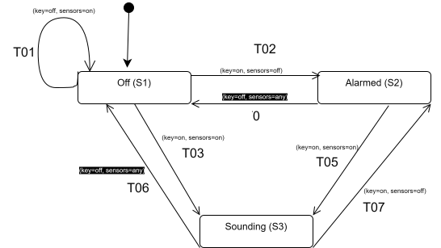

[Back to Main Page](../../README.md)

[Back](./)

## The Burglar Alarm Example 

Modeled state transitions for a Burglar Alarm system to verify requirements and design comprehensive test coverage.

## The Requirements 

R01: A burglar alarm has three states:   
  * Off (S1)
  * Alarmed (the alarm is switched on) (S2)
  * Sounding (S3)
    
R02: The possible inputs are: turning the alarm on or off with a key, and sensors on (movement detected which sounds the alarm) or off.    

The state-transition table that describes the burglar alarm is a follows:

| Requirements ID | Current State | Key | Sensors | Next State | 
| -- | -- | -- | -- |   -- |  
| A01 (Q04) | Off | off  | off |  Off | 
| R03 | Off | off  | on |  Off | 
| R04 | Off | on | off | Alarmed | 
| R05 | Off | on | on | Sounding |  
| R06 | Alarmed | off  | off |  Off | 
| R07 | Alarmed | off | on  |  Off |  
| A02 (Q04)| Alarmed | on | off  |  Alarmed  |  
| R08 | Alarmed | on | on | Sounding | 
| R09 | Sounding | off |  off | Off |
| R10 | Sounding | off |  on | Off |  
| R11 | Sounding | on | off | Alarmed | 
| A03 (Q04) | Sounding | on | on | Sounding  | 

---

## Questions 

| # | Questions to BA |
| :--- | :--- | 
| **Q01** | What type of a key and sensors? (physical key, RFID, keypad; PIR, magnetic, glass-break)  - needed for EP/BVA test design |
| **Q02** | Integration testing: what messages are sent to security/owner in Alarmed and Sounding states? BVA for message content (e.g., wrong-off code or wrong key) | 
| **Q03** | Are there guard conditions for entering Alarmed/Sounding? (e.g., doors/windows must be locked, lights off)  | 
| **Q04** | There is a gap in the requirement: 3 states (Off, Alarmed, Sounding) and combinations of two events (key: on/off and sensors: on/off) = 12 test cases. There are only 9 test cases in the table. Missing ones: 1. Off -> (key=off, sensors=off) -> Off (Assumption A01);  2.  Alarmed -> (key=on, sensors=off) -> Alarmed ( Assumption A02);  Sounding -> (key=on; sensors=on) -> Sounding (Assumption A03) | 
| **A04** |  The system reads both inputs (key and sensors) at the same time as a pair. Each transition is triggered by a combination of key + sensors values, not by a single input change. Handling inputs one-by-one (as separate events) is out of scope — see Q05 | 
| **Q05** | If the key and sensors change one after another (not at the same time), should the system react to each change separately? For example: key turns on first → does the system briefly enter Alarmed? Then sensors turn on -> does it move to Sounding? Or does the system wait and react only to the final combination? | 
| **A05** | The system has no final state - the alarm system operates in a continuous lifecycle. Off is the initial state. Test cases end in the resulting state of the last transition and are not required to return to Off. | 
| **Q06** | Validation: Who are the users and what are their needs? |

---

## [A State Transition Diagram](https://app.diagrams.net/#G14NRQ_vgreyrP4KkJzrxV-850lzoPQe1I#%7B%22pageId%22%3A%22RcJPBvh0yuLYdCqq5FkR%22%7D) 

Diagram shows only requirement-based transitions. Assumption-based transitions (A01–A03) are documented in the state transition table (see below). 

---

## Coverage: 

> * key=on, sensors=off - specific input tuple
> * key=off, sensors=any - sensors can be any value (don't-care)
> * R## - Requirement | Q## - Open question | A## - Documented assumption
> * T## - Requirement-based transition (in diagram)
> * valid - positive test (behavior specified in requirements)
> * invalid - negative test (behavior based on assumption or guard=FALSE)

* 0-switch coverage: 3 states (Off, Alarmed, Sounding) × 4 input combinations (key: on/off × sensors: on/off) = 12 test cases: 

| TC | Type |  Traceability | Current State | Key | Sensors | Next State | Transitions |
| -- | -- | -- | -- | -- | -- |   -- | -- |
| TC01 | invalid | A01 (Q04) | Off | off  | off |  Off (no state change, no alarm)  | - |
| TC02 | valid | R03 | Off | off  | on |  Off | T01 |
| TC03 | valid | R04 | Off | on | off | Alarmed | T02 |
| TC04 | valid | R05 | Off | on | on | Sounding | T03 |
| TC05 | valid | R06 | Alarmed | off  | off |  Off | T04 | 
| TC06 | valid | R07 | Alarmed | off | on  |  Off | T04 |
| TC07 | invalid | A02 (Q04) | Alarmed | on | off  |  Alarmed  (stays armed) | - |
| TC08 | valid |R08 | Alarmed | on | on | Sounding | T05 | 
| TC09 | valid | R09 |  Sounding | off |  off | Off | T06 | 
| TC10 | valid | R10 |  Sounding |  off | on | Off | T06 |
| TC11 | valid | R11 |  Sounding | on | off | Alarmed | T07 |
| TC12 | invalid | A03 (Q04) | Sounding | on | on | Sounding (alarm keeps sounding)  | - | 

 
* Additional test case (TC13) for covering all 3 states and 7 transitions in a single execution:  Off -> (T02) -> Alarmed  -> (T05) -> Sounding -> (T06) -> Off -> (T01) -> Off  -> (T03) -> Sounding  -> (T07) -> Alarmed -> (T04) -> Off 

| TC | Type | Traceability | Step | Current State | Input (key, sensors) | Transition | Next State |
| :-- | :-- | :-- | :-- | :-- | :-- | :-- | :-- |
| TC13 | valid | R04 | 1 | Off | (on, off) | T02 | Alarmed |
| TC13 |  valid  | R08 | 2 | Alarmed | (on, on) | T05 | Sounding |
| TC13 |  valid | R10 | 3 | Sounding | (off, on) | T06 | Off |
| TC13 |  valid | R03  | 4 | Off | (off, on) | T01 | Off |
| TC13 |  valid | R05 | 5 | Off | (on, on) | T03 | Sounding |
| TC13 | valid  | R11  | 6 | Sounding | (on, off) | T07 | Alarmed |
| TC13 | valid  | R06 | 7 | Alarmed | (off, off) | T04 | Off |
 
> The sensors=any don't-care condition on T04 and T06 (concrete variants) is fully validated by TC05/TC06 (T04) and TC09/TC10 (T06) in the 0-switch tests.

---

* 1-Switch Risk-based Coverage Strategy: Alarmed as Anchor State.
* All 1-switch test cases start from the Alarmed state.

---

> * Alarmed is the security-critical hub - the state where the system is actively monitoring for threats.
> * Anchoring every 1-switch test in Alarmed reflects real-world usage: users arm the system, then something happens.
> * Failures originating from Alarmed have the highest business impact (missed intrusion, false alarm, or lockout).
> * Paths of the form Alarmed → [any state] → [any state] collectively exercise all 7 requirement-based transitions (T01–T07) and all 3 assumption-based transitions (A01–A03). This achieves full 1-switch transition coverage with a single, focused starting state.

---

| TC | Type | Traceability | Precondition | Step 1 (key, sensors) | Intermediate | Step 2 (key, sensors) | End State | Path |
| :-- | :-- | :-- | :-- | :-- | :-- | :-- | :-- | :-- |
| TC14 | valid | R06, R03 | Alarmed | (off, off) | Off | (off, on) | Off | T04 -> T01 |
| TC15 | valid | R06, R04 | Alarmed | (off, off) | Off | (on, off) | Alarmed | T04 -> T02 |
| TC16 | valid | R06, R05 | Alarmed | (off, off) | Off | (on, on) | Sounding | T04 -> T03 |
| TC17 | invalid | R06, A01 | Alarmed | (off, off) | Off | (off, off) | Off | T04 -> A01 |
| TC18 | valid | R08, R09 | Alarmed | (on, on) | Sounding | (off, off) | Off | T05 -> T06 |
| TC19 | valid | R08, R11 | Alarmed | (on, on) | Sounding | (on, off) | Alarmed | T05 -> T07 |
| TC20 | invalid | R08, A03 | Alarmed | (on, on) | Sounding | (on, on) | Sounding | T05 -> A03 |
| TC21 | invalid | A02, R06 | Alarmed | (on, off) | Alarmed | (off, off) | Off | A02 -> T04 |
| TC22 | invalid | A02, R08 | Alarmed | (on, off) | Alarmed | (on, on) | Sounding | A02 -> T05 |
| TC23 | invalid | A02, A02 | Alarmed | (on, off) | Alarmed | (on, off) | Alarmed | A02 -> A02 |

---

> **Residual Risk:**
> By focusing 1-switch coverage on Alarmed only, sequence bugs in Off <-> Sounding transitions (bypassing Alarmed) may go undetected. Mitigation: 0-switch coverage validates all transitions individually. Expansion recommended if state complexity grows.

  
---

## Coverage Summary Table

| Coverage Level | Test Cases | Count |
| :-- | :-- | :-- |
| State + Transition coverage (single traversal)  | TC13 | 1 |
| 0-switch full (states × input tuples) | TC01–TC12 | 12 |
| 1-switch coverage (Alarmed anchor) | TC14–TC23 | 10 |
| Total |  | 23 |

---

## Out of Scope

Not covered in this example:

* N-switch coverage for N ≥ 2 (rationale: budget/risk/simplicity)
* Potential EP / BVA for key and sensor inputs (pending Q01 clarification)
* Guard conditions for entering Alarmed/Sounding (pending Q03 clarification)
* Integration testing for security/owner notifications  (pending Q02 clarification)
* Validation (pending Q06 clarification)
* Handling inputs (key, sensors) one-by-one (as separate events) (pending Q05 clarification)

---

See also:

* **[State Transition Testing: Practice Examples](./README.md)** - More practical examples
* **[State Transition Testing](https://olha-yatskivska.github.io/state-transition.htmll)** - Summary of the core concepts from ISTQB Advanced Test Analyst.
* **[State Machine and Transition Diagrams](https://olha-yatskivska.github.io/state-transition-diagram.html)** - Links for the most popular tools.

