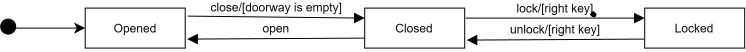

[Back](./)

## The Door Example 

Create a state transition diagram for the following system.

A door can be in one of the following three states:
  * Opened (S1)
  * Closed (S2)
  * Locked (S3)

R01: The door is initially open.   
R02: An open door can be closed if the condition that the doorway is empty is met -  guard condition [doorway is empty].   
R03: A closed door can be opened.   
R04: A closed door can be locked.   
R05: A locked door can be unlocked.

---

## Questions & Assumptions

| # | Questions & Assumptions to BA, PO, Dev |
| :--- | :--- | 
| **Q01** | What is the specific mechanism for opening and closing the door (e.g, manual, automatic, sensor-driven) | 
| **Q02** | What type of locking mechanism is used (e.g., physical key, card, smart electronic keypad?) |  
| **Q03** | How should the system manage physical damage or hardware failures? Should we introduce a "Broken" or "Maintenance" state to the diagram? This may require integration testing with third-party alarm or maintenance services. | 
| **Q04** | Validation: who is the primary end-user? Are there specific physical attributes required (e.g., transparent window, wall stoppers), safety requirements (e.g. child safety locks), or accessibility needs (e.g., an automated pet door)? | 
| **A05** | How should the system respond to invalid events in each state? (e.g., pressing "lock" when door is Opened, or "open" when Locked)? **Assumption:  event is ignored, no state change.**  | 
| **A06** | **Assumption:** The system has no terminating (final) state — the door operates in a continuous lifecycle. Opened is the initial state. Test cases end in the resulting state of the last transition and are not required to return to Opened.  | 
| **A07** | The locking mechanism requires authentication. **Assumption:** A guard condition [right key] applies to both lock and unlock events. Without the correct key, the transition does not occur. | 

## [A State Transition Diagram](https://app.diagrams.net/#G14NRQ_vgreyrP4KkJzrxV-850lzoPQe1I#%7B%22pageId%22%3A%22m_ZY6zu62SAlbmcle9p6%22%7D) 

Coverage: 

* State coverage: Opened -> Closed -> Locked;
  
* Transition coverage: Opened -> Closed -> Locked -> Closed -> Opened;

To visualize negative test cases and show 0-switch coverage a state transition table can be used (3 states (S1, S2, S3) + 4 events (close, open, lock, unlock) = 12 test cases 

---

> R## — Requirement ID    
> Q## — Open question to stakeholders     
> A## — Documented assumption    
> [guard] — Guard condition (must be TRUE for transition to occur)    
> Type: valid — Positive test (expected behavior)    
> Type: invalid — Negative test (unexpected input or guard = FALSE)

----

| TC | Type | Current State | Event | Next State |  Traceability |
| -- | -- |  -- | -- |  -- |  -- |
| TC01 | valid | **Opened** | **close [doorway is empty]** |  **Closed** | R01, R02 |
| TC02 | invalid | Opened | open |  Opened (Stays open) |  A05 |
| TC03 | invalid | Opened | lock | Opened (Cannot lock) |  A05 |
| TC04 | invalid | Opened | unlock | Opened (Stays open) |  A05 |
| TC05 | invalid | Closed | close  |  Closed (Stays closed) | A05 |
| TC06 | valid | **Closed** | **open**  |  **Opened** |  R03 |
| TC07 | valid | **Closed**| **lock/[right key]** |  **Locked** | R04, A07 |
| TC08 | invalid | Closed | unlock |  Closed (Already unlocked) | A05 |
| TC09 | invalid | Locked | close |  Locked (Already closed and locked) | A05 |
| TC10 | invalid | Locked | open |  Locked (Cannot open) | A05 |
| TC11 | invalid | Locked | lock |  Locked (Already locked) | A05 |
| TC12 | valid | **Locked** | **unlock/[right key]**  | **Closed** | R05, A07 | 

Additional invalid test cases for guard conditions ([doorway is empty] and [right key])

| TC | Type  | Current State | Event | Next State | Traceability |
| -- | -- |  -- | -- |  -- |  -- | 
| TC13 | invalid | Opened | close/[doorway is not empty] |  Opened (Stays open) | R02 | 
| TC14 | invalid | Closed | lock/[wrong key]|  Closed (Cannot lock) | A07 | 
| TC15 | invalid | Locked | unlock/[wrong key] | Locked (Cannot unlock) | A07 | 

To add depth to the coverage can use 1-switch coverage for all states  (the switches depend on budget/time/risk):
 
  * Opened -> Closed -> Locked (TC16)
  * Opened -> Closed -> Opened (TC17)
  * Closed -> Opened -> Closed (TC18)
  * Closed -> Locked -> Closed (TC19)
  * Locked -> Closed -> Opened (TC20)
  * Locked -> Closed -> Locked (TC21)
 
 According to the A06 Assumption test cases with 1-switch coverage for all states would look like this: 
  
| TC ID | Type | Precondition (Start) | Step 1 | Step 2 | End State | Traceability |
| :-- | :-- | :-- | :-- | :-- | :-- | :-- |
| TC16 | valid | Opened | close [doorway is empty] | lock | Locked |  R02, R04 |
| TC17 | valid | Opened | close [doorway is empty] | open | Opened | R02, R03 |
| TC18 | valid | Closed | open | close [doorway is empty] | Closed | R03, R02 |
| TC19 | valid | Closed | lock [right key] | unlock [right key] | Closed | R04, R05, A07 |
| TC20 | valid | Locked | unlock [right key] | open | Opened |  R05, R03, A07 | 
| TC21 | valid | Locked | unlock [right key] | lock [right key] | Locked | R05, R04, A07 |

---

## Coverage Summary Table

| Coverage Level | Test Cases | Count |
| :-- | :-- | :-- |
| State coverage (all states visited) | TC01, TC07, TC12 | 3 |
| Transition coverage (all 0-switch) | TC01, TC06, TC07, TC12 | 4 |
| 0-switch full (states × events) | TC01–TC12 | 12 |
| Guard condition negative | TC13, TC14, TC15 | 3 |
| 1-switch coverage | TC16–TC21 | 6 |
| Total |  | 21 |

---

## Out of Scope

Not covered in this example:

* N-switch coverage for N ≥ 2 (rationale: budget/risk/simplicity)
* Potential EP / BVA and performance issues for closing and locking mechanism (pending Q01-Q02 clarification)
* Broken/Maintenance state (pending Q03 clarification)
* Validation (pending Q04 clarification)

See also:

* **[State Transition Testing: Practice Examples](./README.md)** - More practical examples
* **[State Transition Testing](https://olha-yatskivska.github.io/state-transition.htmll)** - Summary of the core concepts from ISTQB Advanced Test Analyst.
* **[State Machine and Transition Diagrams](https://olha-yatskivska.github.io/state-transition-diagram.html)** - Links for the most popular tools.

**[Back to Main Page](./)**

